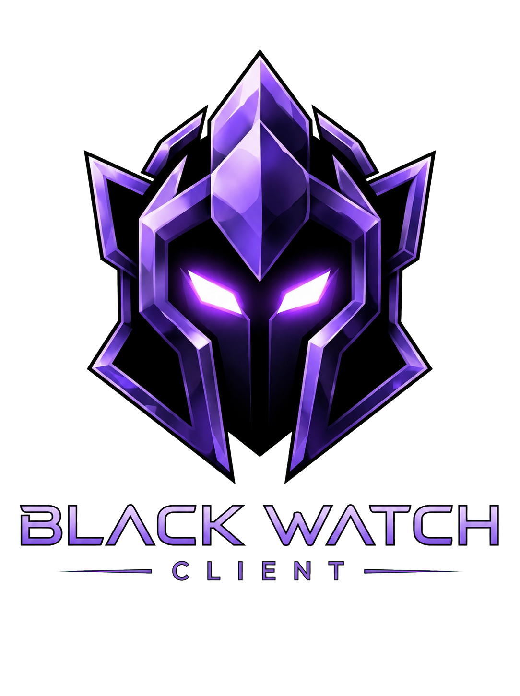

  

# Black Watch

**An independent Minecraft: Java Edition client and launcher for Windows.**

Alpha in preparation · Customisable gameplay · Original cosmetics · Performance-focused development

[Deutsch](docs/PROJEKT-DE.md) · [Alpha roadmap](docs/ALPHA.md) · [Microsoft sign-in and API access](docs/AUTHENTICATION.md)

## What is Black Watch?

Black Watch is an independently developed client and desktop launcher for Minecraft: Java Edition on Windows. Our goal is to make Minecraft smooth, straightforward and customisable to use. The project combines game profile management with a configurable interface, practical in-game tools and original cosmetics.

Players can arrange their HUD displays, adjust their size and visibility, and manage profiles with their chosen mods and resource packs. The project also includes waypoints, inventory search and a customisable crosshair. Original cosmetics provide additional ways to personalise the player's appearance. These features are intended to form a coherent, easy-to-use client.

## Built around the player

| Area | What Black Watch brings together |
| --- | --- |
| Launcher and profiles | Manage game profiles with chosen mods and resource packs. |
| HUD and interface | Arrange displays and adjust their size and visibility. |
| Practical tools | Waypoints, inventory search and a customisable crosshair. |
| Cosmetics | Original capes, halos, auras, bands and other visual customisations. |
| Performance | Ongoing CPU and GPU work to reduce unnecessary processing while retaining appearance and functionality. |

These features are under active development and are being brought together for the alpha. Current cosmetics render locally; visibility to other players is not part of the confirmed alpha feature set.

## Performance with a clear purpose

Performance is a central development priority. We aim to reduce unnecessary processing and resource use and achieve stable, smooth gameplay across different computers, making the client practical for a broad range of players. Actual improvements on different hardware will be evaluated through testing and feedback; we do not promise a specific frame-rate increase in advance.

## Why we need Minecraft Services access

Our immediate goal is to let alpha participants sign in with their own Microsoft accounts and use their Minecraft profiles in Black Watch. Participants must have access to Minecraft: Java Edition on their account. The requested access supports account authentication, profile retrieval and launching the game with the authenticated player identity.

The launcher implements Microsoft's device authorization flow, followed by Xbox Live/XSTS and Minecraft Services authentication. Microsoft credentials are entered on Microsoft's website, not in Black Watch. More details are available in the [sign-in overview](docs/AUTHENTICATION.md).

This project page supports the review of Black Watch's own Microsoft application registration. Minecraft Services access approval is being prepared and is not yet confirmed.

## Alpha first, then beta

The first phase focuses on real-world testing of sign-in, first-run setup, stability, usability, cosmetics and performance on different computers. Feedback will help identify defects and prioritise improvements. A successful alpha will be followed by a beta, with public release planned after those testing phases.

The long-term aim is to establish Black Watch as a capable, approachable and individually customisable Minecraft client. There is no announced release date. Alpha participation and download details will be published when the first test release is ready. See the [alpha roadmap](docs/ALPHA.md).

## About this repository

This is the public project overview for Black Watch. It contains the project description and alpha plans. Client source code, game files and downloadable builds are not included in this repository.

Black Watch is currently an independently developed hobby project. It is not an official Minecraft product and is not affiliated with or endorsed by Mojang or Microsoft.
